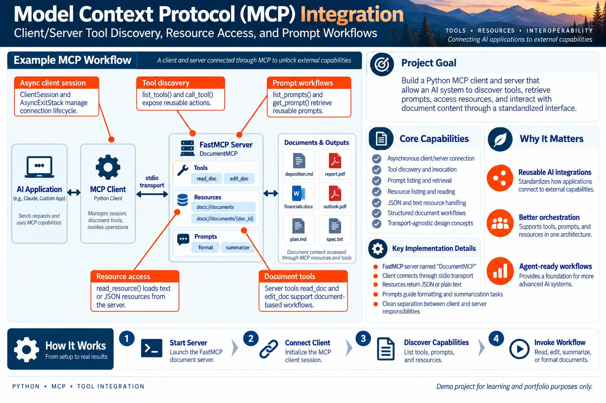

# Model Context Protocol (MCP) Integration

### Python | MCP Client & Server | Tool Discovery | Resources | Prompt Workflows

## Overview

This project demonstrates how a Python client and server communicate using the **Model Context Protocol (MCP)**. The `DocumentMCP` example server exposes document-related **tools**, **resources**, and **prompt templates** over standard input/output (`stdio`). A client discovers those capabilities and invokes them through a standardized interface.

The project includes a standalone, **API-key-free MCP smoke test** that demonstrates client/server communication and validates the document-oriented tools, resources, and prompt templates. This portfolio package organizes an MCP learning project into a focused, reproducible integration example.

**Scope:** This is an instructional implementation with synthetic document *text held in memory*. It does not open actual PDFs, DOCX files, or Markdown files on disk. Document edits last only until the server exits.

## Visual Demonstration



*Illustrative architecture diagram of the Python MCP client/server demonstration. It depicts connection through `stdio`, discovery and invocation of document tools, retrieval of resources, and reusable prompt templates. The diagram is a conceptual explanation, not a screenshot proving an executed integration test.*

## Implemented MCP Capabilities

| MCP component | Example | Behavior |
|---|---|---|
| Tools | `read_doc(doc_id)` | Returns the example document's stored text |
| Tools | `edit_doc(doc_id, new_content)` | Updates the in-memory document text |
| Resource | `docs://documents` | Returns the available document identifiers as JSON |
| Resource template | `docs://documents/{doc_id}` | Retrieves the stored text of one document |
| Prompt template | `format(doc_id)` | Returns instructions for Markdown formatting using document tools |
| Prompt template | `summarize(doc_id)` | Returns instructions for summarizing a document |

**Important distinction:** Retrieving a prompt template does not invoke an AI model or automatically reformat or summarize the document. The demo demonstrates MCP prompt retrieval, not model-generated content.

## Architecture

```text
Python MCP Client
             |
         stdio session
             |
     DocumentMCP Server
        |     |     |
      Tools Resources Prompts
        |     |     |
   read_doc   docs://documents   format
   edit_doc   docs://documents/  summarize
              {doc_id}
             |
     In-memory dictionary
   (six synthetic text entries)
```

## Repository Structure

```text
mcp-client-server-integration/
├── mcp_server.py               # FastMCP DocumentMCP server
├── mcp_client.py               # ClientSession/stdio implementation
├── demo_workflow.py            # API-key-free tool/resource/prompt smoke test
├── visualizations/
│   └── mcp_integration_demo.png
├── .gitignore
├── pyproject.toml
└── README.md
```

## Local Setup

1. Install Python 3.10 or newer and create a virtual environment.

   ```bash
   python -m venv .venv
   ```

2. Activate it (Windows PowerShell):

   ```powershell
   .\.venv\Scripts\Activate.ps1
   ```

   On macOS/Linux use `source .venv/bin/activate`.

3. Install the project dependencies:

   ```bash
   python -m pip install -e .
   ```

The dependency range intentionally retains the **MCP Python SDK v1 API**, matching the FastMCP and `ClientSession` source code included here. The SDK's newer major versions have different interfaces and may require migration.

## Demonstrate the MCP Connection (No API Key Required)

Run:

```bash
python demo_workflow.py
```

This test attempts to:

1. Start the `DocumentMCP` server using the active Python interpreter.
2. Establish an asynchronous MCP `stdio` session.
3. Discover the `read_doc` and `edit_doc` tools.
4. Discover the `format` and `summarize` prompts.
5. List available document IDs and read example document text.
6. Edit one document and verify its updated content through a resource URI.
7. Retrieve a prompt template.

A successful run ends with `PASS: MCP tool, resource, and prompt smoke test`.

**Validation status:** **Local MCP smoke test passed on Windows (November 2026).** The user ran `demo_workflow.py` in VS Code after installing the dependencies, confirming the client/server connection, tool discovery and invocation, document updates, resource retrieval, and prompt retrieval. Example output:

```text
Read demo document: The report details the state of a 20m condenser tower.
Updated document resource: Updated test content (in memory only).
PASS: MCP tool, resource, and prompt smoke test
```

This is a successful **user-run local integration test**. It has not yet been reproduced in an independent clean environment or automated through CI.

You can also list capabilities with:

```bash
python mcp_client.py
```

## In-Memory Document Design

The six example document IDs, including `report.pdf` and `financials.docx`, are keys in a Python dictionary. Their associated values are synthetic text descriptions, not the actual contents of files with those extensions.

This design is useful for a **focused protocol demonstration** because readers can observe tool calls and resource updates without managing filesystem permissions, binary document parsers, or persistent storage.

The limitation is that changes are not saved to disk and disappear when the server process exits. A later enhancement could use a dedicated example-files directory or a persistent document store with path validation and access controls.

## Safety and Limitations

- Tool calls operate on predefined synthetic entries; arbitrary file paths cannot be read through these tools.
- The server does not currently parse real PDF, Word, or Markdown files.
- `format` and `summarize` are prompt templates; actual LLM execution requires a connected model-powered client.
- Server state resets after restart; persistence, authentication, authorization, and audit logging are not implemented.
- Any production adaptation would require broader testing, input validation, secure storage, and permission controls.

## Future Development

- Reproduce the passing local smoke test in a clean environment and automate it through CI.
- Add persistent, sandboxed file-backed document storage.
- Support actual text extraction and editing for supported document formats.
- Add automated regression tests, permission controls, and audit events.
- Explore deployment using other MCP transport options as needed.

## Project Significance

This project demonstrates the foundations of **AI systems interoperability**: connecting a client to a separately implemented service, discovering reusable tools and resources, and using standardized prompt templates for document-oriented workflows.

The project provides practical examples of asynchronous Python programming, client/server communication, tool invocation, structured resource retrieval, and the separation of AI application logic from externally exposed capabilities.

---

**Project Type:** Applied AI & MCP Integration Portfolio Project  
**Technologies:** Python, MCP Python SDK (v1), FastMCP, asyncio, Pydantic  
**Core Methods:** Client/Server Architecture, Tool Discovery, Tool Invocation, Resource Access, Prompt Retrieval  
**Data Classification:** Synthetic / Demonstration Document Text  
**Implementation:** Local `stdio` MCP Client and DocumentMCP Server  
**Project Status:** Core MCP Integration Locally Validated (Smoke Test Passed)  

**Developed by Glahnnia "Renee" Rates, MSHS, CCHW II**  
Public Health Informatics | Applied AI | Workforce Development | Data Analytics
